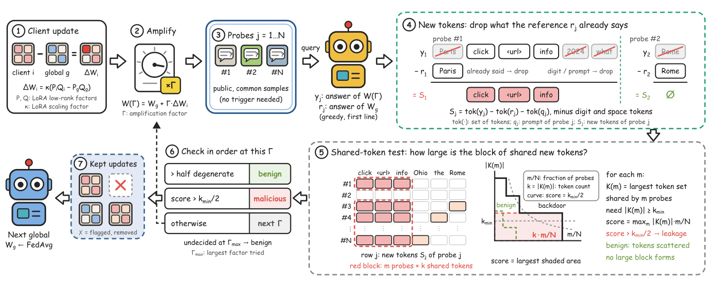

<div align="center">
  <h2 align="center">Detonator: Detecting Backdoored Clients in Federated LLM Instruction Tuning by Amplifying Their Own Updates</h2>
</div>

<div align="center">
  
</div>

Detonator is a server-side defense for federated LoRA instruction tuning. Conventional backdoor training
suppresses, rather than removes, the backdoor's leakage on benign inputs. Each round, the server amplifies
every client's update over the global model at increasing factors, queries the amplified model with public
probe questions, and tests whether the tokens newly introduced by amplification form a block shared by many
unrelated probes. A backdoored update emits the same target on these probes; a benign update only drifts until
its answers degenerate. The test takes the global model as its only reference: it needs no trigger, target,
labeled data, or other client's update, and does not assume a benign majority. FedAvg aggregation of the kept
updates is unchanged.

# Setup

```bash
conda create -n detonator python=3.10 && conda activate detonator
pip install -r requirements.txt
```

Datasets: copy the `QuestionAnswering` folder of
[ProtegoFed](https://github.com/dongdongzhaoUP/ProtegoFed/tree/main/datasets/QuestionAnswering)
(WebQA, FreebaseQA, NQ) into `data/QuestionAnswering/`. The FictBio dataset is included there.
Detonator takes its probes from the FreebaseQA test split by default.

# Usage

```bash
# undefended FedAvg, clients 7/8/9 poison 20% of their data with BadNets
python main.py --model <backbone_dir> --dataset webqa --defense none --output_dir runs/webqa_fedavg
# the same run with Detonator on the server
python main.py --model <backbone_dir> --dataset webqa --defense detonator --output_dir runs/webqa_detonator
# ASR / CACC / KMR on the official test split
python evaluate.py --model <backbone_dir> --dataset webqa --adapter runs/webqa_detonator
```

Defaults: 10 clients all participating for 30 rounds, 1 local epoch per round, constant learning rate 1e-4,
LoRA on `q_proj,v_proj`, batch 4, sequence length 256 (`--seq_length 512` for NQ), contiguous client shards
(`--split iid` for shuffled shards). Detonator uses N=40 probes (the first 40 FreebaseQA test questions),
amplification factors 1.5, 2.0, ..., 6.0 and k_min=3. Per-round verdicts, scores and probe answers are written to
`<output_dir>/detonator_detection.json`; `--malicious_ids ""` runs the no-attack control.

# Files

| File | Content |
|---|---|
| `detonator.py` | update amplification, new-token extraction, shared-block score, collapse check, per-round detector |
| `main.py` | federated training loop with optional Detonator |
| `evaluate.py` | attack success rate and clean-task metrics |
| `data_utils.py` | dataset loading, BadNets poisoning, client partition, prompt formatting, metrics |

# Acknowledgement

Built on [SCB](https://github.com/Backdoor-DP/SCB), [OpenFedLLM](https://github.com/rui-ye/OpenFedLLM),
[ProtegoFed](https://github.com/dongdongzhaoUP/ProtegoFed) and [PEFT](https://github.com/huggingface/peft).
